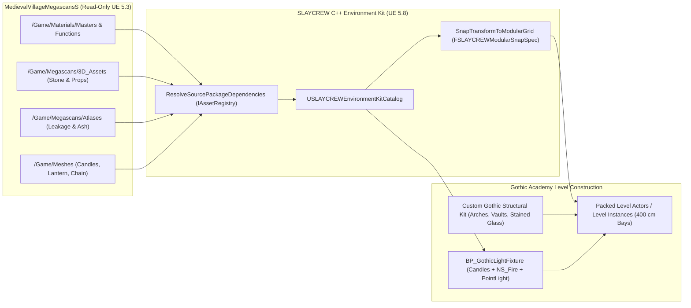

# SLAYCREW — Gothic Academy Environment Kit Plan & Asset Inventory

## 1. Executive Summary & Creative Direction

**SLAYCREW** opens at a prestigious Gothic monster-slayer academy where the playable protagonist and four close companions attend their graduation ceremony. The academy's proper name is intentionally undecided and is referred to throughout this document and codebase strictly as **the Gothic Academy**.

### Architectural Vision
The academy must project elegance, institutional prestige, verticality, and atmospheric solemnity—distinct from a rustic or peasant medieval village:
- **Structural vocabulary:** Pointed lancet and equilateral arches, quadripartite ribbed stone vaults, clustered pier columns, tall bell and observatory towers, flying buttresses, and carved ashlar masonry.
- **Fenestration & lighting:** Tall pointed tracery windows, rose windows, emissive stained glass casting colored light shafts across stone floors, wrought-iron lanterns, suspended iron chandeliers, and clustered wax candles with subsurface scattering.
- **Spatial layout:** Cloistered courtyards, monumental ceremonial staircases, a grand graduation hall (nave/chancel layout), library/tactical study halls, dormitory cloisters, and a lower armory/crypt.

### Source Sample Context
- **Source Project (Read-Only):** `D:\Unreal Projects\MedievalVillageMegascansS\MedievalVillageMegascansS.uproject` (authored as the UE 5.3 Medieval Village Megascans Sample, ~16.32 GB of packaged assets across 2,726 files in `Content/` excluding `__ExternalActors__`, ~20 GB total on disk).
- **Target Project:** `D:\GitHub\SLAYCREW-Argon\SLAYCREW.uproject` (Unreal Engine **5.8.4**).
- **Core Finding:** The source sample is predominantly a **rural Nordic/medieval timber-and-thatch village**. It **does not contain** Gothic pointed arches, ribbed vaults, stained glass, stone tracery, or tall masonry towers. However, it contains high-quality **dressed stone floor slabs, stone stairs, masonry walls, cobblestone surfaces, weathering decals, wax candles, wrought-iron lanterns, iron chains, heavy oak furniture, climbing ivy, and fire/incense VFX** that form a strong secondary dressing, surface, and prop foundation for the Gothic Academy kit.

---

## 2. Source Project Inspection & Naming Conventions

### 2.1 Top-Level `Content/` Directory Breakdown
Inspection of `D:\Unreal Projects\MedievalVillageMegascansS\Content` (excluding World Partition `__ExternalActors__` and `__ExternalObjects__`):

| Content Subfolder | File Count | Size (MB) | Primary Contents & Reusability Summary |
| :--- | ---: | ---: | :--- |
| `/Game/Megascans` | 1,137 | 8,263.77 | Quixel Megascans `3D_Assets` (112 folders), `3D_Plants` (19 folders), `Atlases` (12 folders), `Surfaces` (8 folders). Selective reuse only. |
| `/Game/Meshes` | 634 | 5,376.31 | Custom sample props (`Candles`, `Lantern`, `Chain`, `Flag`, `Rope`) and rural `Houses` (2,985.62 MB) / `Fences` (653.58 MB) / `Scarecrow` (361.76 MB). |
| `/Game/Materials` | 91 | 1,289.43 | `Masters/` (20 files, 1.20 MB), `Functions/` (15 files, 37.43 MB), `Landscape/` (47 files, 1,249.79 MB). `Masters` & `Functions` are essential dependencies. |
| `/Game/ThirdParty` | 211 | 758.06 | `AnimalVarietyPack/Crow`, `M5VFXVOL2` (fire/smoke flipbooks), `PN_interactiveSpruceForest`. |
| `/Game/Audio` | 475 | 566.96 | MetaSounds, Soundscape palettes, Bink/WAV ambiences and footsteps (requires audio plugins not currently enabled in `SLAYCREW`). |
| `/Game/Effects` | 55 | 58.28 | Niagara & Cascade VFX: `Flames`, `Embers`, `IncenseSmoke`, `Leaves`, `VolumeFog`, `LocalFog`, `Birds`. |
| `/Game/Blueprints` | 77 | 7.92 | Sample-specific FP controller, commentary boxes, performance benchmark, and `BP_FenceTool`. |
| `/Game/MSPresets` | 1 | 2.08 | `MSTextures/noise_mask`. |
| `/Game/Maps` | 18 | 1.54 | `MedievalVillage_P_WP` World Partition map, DataLayers, HLODLayers (do not migrate). |
| `/Game/Cinematics` | 5 | 0.65 | Sample sequencer shots (do not migrate). |
| `/Game/Environment` | 16 | 0.04 | Landscape `LayerInfo` and Procedural Foliage Spawners (`PFS_*`). |
| `/Game/PhysMat` | 5 | 0.01 | `PM_Cobblestone`, `PM_Dirt`, `PM_Undergrowth`, `PM_Wood`, `PM_Wood_Tree`. |

### 2.2 Asset Naming Conventions
All assets in the sample strictly follow Unreal Engine prefix/suffix conventions, which must be preserved when migrating or authoring new Gothic Academy kit assets:

| Prefix / Suffix | Asset Type | Example in Sample |
| :--- | :--- | :--- |
| `SM_` | `StaticMesh` | `SM_DamagedCastleStairs`, `SM_Candles_01` |
| `SK_` / `PA_` | `SkeletalMesh` / `PhysicsAsset` | `SK_FlagA`, `PA_FlagA` |
| `M_` | `Material` (Master Material) | `M_StandardMaster`, `M_BlendMaster`, `M_SSSMaster`, `M_DecalMaster` |
| `MI_` | `MaterialInstanceConstant` | `MI_DamagedCastleStairs`, `MI_Candles_01`, `MI_WallRustLeakage` |
| `MF_` | `MaterialFunction` | `MF_Alebdo`, `MF_NormalStrength`, `MF_Roughness`, `MF_UVManip` |
| `SSP_` | `SubsurfaceProfile` | `SSP_Candles` |
| `GPC_` | `MaterialParameterCollection` | `GPC_GloablRGB_Blend`, `GPC_VolClouds` |
| `T_*_A` | `Texture2D` — Albedo / BaseColor | `T_DamagedCastleStairs_A` |
| `T_*_N` | `Texture2D` — Normal Map | `T_DamagedCastleStairs_N` |
| `T_*_R` | `Texture2D` — Roughness | `T_DamagedCastleStairs_R` |
| `T_*_RMF` | `Texture2D` — Packed Roughness / Metallic / Fuzz | `T_Chain_RMF`, `T_OldWoodenTable_RMF` |
| `T_*_O` / `T_*_AO` | `Texture2D` — Opacity / Ambient Occlusion | `T_WallRustLeakage_O`, `T_LeakageA_AO` |
| `T_*_D` | `Texture2D` — Displacement / Height | `T_Cobblestone_D` |
| `T_*_MaskRGB` | `Texture2D` — RGB Layer Blend Mask | `T_MedievalModularCornerWall1x2M_MaskRGB` |
| `F_` / `PFS_` | `FoliageType_InstancedStaticMesh` / `ProceduralFoliageSpawner` | `F_EnglishIvy_00`, `PFS_Forest` |
| `NS_` / `P_` | `NiagaraSystem` / `ParticleSystem` | `NS_Fire`, `NS_Embers`, `P_Incense_Loop` |
| `PM_` | `PhysicalMaterial` | `PM_Cobblestone`, `PM_Wood` |
| `RVT_` / `SVT_` | `RuntimeVirtualTexture` / `SparseVolumeTexture` | `RVT_Landscape_01` |

---

## 3. Suitability Classification: Gothic Academy vs. Rural Medieval Village

To prevent visual dilution of the Gothic Academy setting and avoid unnecessary Git LFS storage consumption, all source assets are classified into three suitability tiers (`ESLAYCREWGothicSuitability`):

### Tier 1: `DirectReuse` — Genuinely Appropriate for the Gothic Academy
Assets that fit a stone-built, ceremonial Gothic institution without breaking architectural coherence:
1. **Dressed Stone Paving & Masonry:** `JapaneseShrineStoneFloorA`, `JapaneseShrineStoneFloorB`, `JapaneseShrineStoneFloorC` (clean rectilinear ashlar stone slabs without culture-specific iconography—ideal for cloister walkways, dais platforms, and interior stone floors), `DamagedCastleStairs`, `CastleWall`, `StoneWall`, `MossyStoneWallA/B`, and `Surfaces/Cobblestone`.
2. **Ceremonial Lighting & Ironwork:** `Meshes/Candles` (`SM_Candles_01..03` with subsurface wax shader `M_SSSMaster`), `Meshes/Lantern` (`SM_ManMade_Lantern_01..02`), `Meshes/Chain` (`SM_Chain_01..02`, `BP_Swaying_Chain`), `WallMountedMetalHook`, `PileOfChains`, `Effects/Flames` (`NS_Fire`, `M_CandleFlame`), `Effects/Embers` (`NS_Embers`), and `Effects/IncenseSmoke` (`P_Incense_Loop`).
3. **Institutional Furniture, Doors & Memorials:** `OldWoodenBench` (lecture hall/chapel pews), `OldWoodenTable` (refectory/study tables), `OldWoodenDoor` (heavy iron-studded timber doors), `OldWoodenChest` (dormitory/armory chests), `OldWoodenCarafe`, `Sword` (armory/ceremonial blade), `GraveA` and `GraveB` (fallen monster-slayer memorial stones in the cloister).
4. **Weathering Decals & Cloister Foliage:** `WallRustLeakage`, `LeakageA`, `LeakageB`, `LeakageC`, `Ash`, `BloodStain`, `HighVelocityBloodSpatter`, `HandSmear`, `EnglishIvy`, `CreeperIvy`, `FernB`, `IcelandicMossClusters`, `MattedPratia`.

### Tier 2: `ConditionalSecondaryReuse` — Restricted / Secondary Contexts Only
Assets usable only in concealed structural, subterranean, or exterior perimeter contexts:
1. **Structural Timber Framing (`WoodenBeam`, `WornWoodenBeamA/B`, `WoodenPlank`, `WoodenPost`, `SupportBeamA/B/D/E`):** Use *only* for high interior hammerbeam roof trusses, belfry scaffolding, or basement storage—never as exterior half-timber cottage facades.
2. **Armory / Forge Props (`Furnace`, `BlacksmithAnvilA/C/E`, `BlacksmithHammer`, `BlacksmithTongs`, `OldBellows`, `CoalA/B`, `BlacksmithDecal`, `WoodenBarrelB/C`, `WoodenBox`, `WoodenAmmoCrate`):** Suitable only for a dedicated monster-hunter weapon maintenance/smithy annex or cellar.
3. **Cliff & Promontory Foundations (`GraniteRockAssembly`, `HovsBeachRock`, `IcelandicBoulder`, `MossyEmbankmentA–E`, `MossyRocksA/B`):** Suitable for exterior cliff faces anchoring the academy's perimeter walls.

### Tier 3: `ExcludeRuralVillage` — Do Not Import for the Gothic Academy
Assets that read unmistakably as an agrarian peasant village and must be excluded from the Gothic Academy kit:
- **Rural Cottages & Thatch Roofing (~3.60 GB):** `/Game/Meshes/Houses/*` (`Thatch_Cards`, `Roofs/House02..08_Roof`, `MODULAR_ASSETS/Forge`, `LogWall`, `Porch`, `WindowShutter`) and `/Game/Megascans/3D_Assets/MedievalModular*` (wattle-and-daub and rough cottage wall panels, ~617 MB).
- **Wattle & Branch Fences (~653.58 MB):** `/Game/Meshes/Fences/*`, `/Game/Blueprints/Tools/BP_FenceTool`, `PalisadeSpike`, `PalisadeStrutA/B`.
- **Agrarian & Peasant Clutter (~1.15 GB):** `Scarecrow` (361.76 MB), `WindmillWings` (113.25 MB), `Well` / `WellHole` / `OldWellCrank` (123.68 MB), `Townsign` (79.04 MB), `HorseHitchingPost` (70.41 MB), `HorseManure` (18.07 MB), `MedievalButterChurn` (18.37 MB), `OldScythe` (74.01 MB), `OldSaddle` (21.70 MB), `OldShovel` (18.94 MB), `OldWoodenTrough` (18.64 MB), `WoodenWheelA/B` & `WoodenWheelbarrow` (63.97 MB), `Carrot` (48.43 MB), `PotatoA/B` (111.05 MB), `Wanted` / `Poster01/02` (174.36 MB).
- **Modern/Anachronistic Decals:** `MuddyAsphaltPothole` (16.46 MB), `RoadDamage` (3.34 MB).

---

## 4. Curated Gothic Academy Asset Inventory

All paths below use their exact `/Game/...` package roots from `MedievalVillageMegascansS`. Sizes reflect exact measurements on disk, along with full transitive package closure sizes (including required master materials, material functions, and base textures).

### 4.1 Core Shared Material Dependency Foundation
Every migrated mesh or decal depends on a small set of shared Master Materials and Material Functions:

| Asset ID | Original Path (`/Game/...`) | Category | Files | Folder Size | Notes / Transitive Closure |
| :--- | :--- | :--- | ---: | ---: | :--- |
| `M_StandardMaster` | `/Game/Materials/Masters/M_StandardMaster` | Master Material | 9 | 0.40 MB | Uses `MF_Alebdo`, `MF_Fuzz`, `MF_NormalStrength`, `MF_Roughness`, `MF_UVManip`, and `BaseTextures/T_Default_*`. Zero RVT dependency. |
| `M_SSSMaster` | `/Game/Materials/Masters/M_SSSMaster` | Master Material | 9 | 0.36 MB | Uses `SSP_Candles` subsurface profile + 4 core `MF_*` functions + `T_Default_*`. Used by `Candles`. |
| `M_DecalMaster` | `/Game/Materials/Masters/M_DecalMaster` | Master Material | 7 | 0.38 MB | DBuffer/translucent decal master material. Uses `MF_Alebdo`, `MF_NormalStrength`, `MF_Roughness`, `T_Default_*`. |
| `M_CutoutMaster` | `/Game/Materials/Masters/M_CutoutMaster` | Master Material | 8 | 0.36 MB | Masked opacity master material for foliage cards and frayed cloth/rope. |
| `M_BlendMaster` | `/Game/Materials/Masters/M_BlendMaster` | Master Material | 14 | 9.10 MB | Used by Megascans stone architecture; references `MF_BlendRVTMaterial`, `T_Mask` (8.49 MB), and `RVT_Landscape_01` / `RVT_Landscape_Height_01`. |
| `M_FoliageCustomWind` | `/Game/Materials/Masters/M_FoliageCustomWind` | Master Material | 10 | 0.50 MB | Wind-animated foliage master material used by `EnglishIvy` and `CreeperIvy`. |
| `PhysMat_Core` | `/Game/PhysMat/PM_Cobblestone`, `PM_Wood`, `PM_Dirt` | Physical Material | 5 | 0.01 MB | Referenced by `MI_CastleWall`, `MI_OldWoodenChest`, etc. for surface footstep/impact queries. |

### 4.2 Architecture, Surfaces, Decals, Props, Foliage & VFX Shortlist

| Asset ID | Original Path (`/Game/...`) | Category | Suitability | Folder MB | Transitive MB | Master Material | Proposed Gothic Academy Use Case |
| :--- | :--- | :--- | :--- | ---: | ---: | :--- | :--- |
| `JapaneseShrineStoneFloorA` | `/Game/Megascans/3D_Assets/JapaneseShrineStoneFloorA` | Architecture (Stone) | `DirectReuse` | 20.19 | 29.16 | `M_BlendMaster` | Dressed ashlar stone paving slab (`244.2 x 254.0 x 21.7 cm`, 6 LODs, Nanite-enabled) for cloister walkways, chancel dais, and courtyard paving. |
| `JapaneseShrineStoneFloorB` | `/Game/Megascans/3D_Assets/JapaneseShrineStoneFloorB` | Architecture (Stone) | `DirectReuse` | 21.82 | 30.79 | `M_BlendMaster` | Ashlar stone floor border/platform module for ceremonial hall and quadrangle. |
| `JapaneseShrineStoneFloorC` | `/Game/Megascans/3D_Assets/JapaneseShrineStoneFloorC` | Architecture (Stone) | `DirectReuse` | 23.14 | 32.11 | `M_BlendMaster` | Two-mesh (`_00`, `_01`) stepped ashlar stone slab for terrace transitions. |
| `DamagedCastleStairs` | `/Game/Megascans/3D_Assets/DamagedCastleStairs` | Architecture (Stone) | `DirectReuse` | 21.38 | 30.35 | `M_BlendMaster` | Modular carved stone step block (`51.4 x 44.6 x 25.2 cm`, 6 LODs, Nanite-enabled; matches `50 x 25 cm` stair grid) for courtyard steps and crypt transitions. |
| `CastleWall` | `/Game/Megascans/3D_Assets/CastleWall` | Architecture (Stone) | `DirectReuse` | 68.85 | 77.82 | `M_BlendMaster` | Heavy coursed stone curtain wall module for academy perimeter walls and retaining buttresses. |
| `StoneWall` | `/Game/Megascans/3D_Assets/StoneWall` | Architecture (Stone) | `DirectReuse` | 78.33 | 87.30 | `M_BlendMaster` | Low stone parapet/parterre wall for courtyard quadrangle divisions and combat training ring boundaries. |
| `MossyStoneWallB` | `/Game/Megascans/3D_Assets/MossyStoneWallB` | Architecture (Stone) | `DirectReuse` | 24.86 | 33.83 | `M_BlendMaster` | Compact weathered stone wall module for older academy garden terraces (preferred over 573 MB `MossyStoneWallC`). |
| `Cobblestone` | `/Game/Megascans/Surfaces/Cobblestone` | Surface Material | `DirectReuse` | 296.39 | 305.36 | `M_BlendMaster` | High-detail cobblestone material and displacement meshes (`SM_Cobblestone_00/01`) for main courtyard paving. |
| `SlateRoof_Textures` | `/Game/Meshes/Houses/MODULAR_ASSETS/CustomOutcrop/Textures/SlateRoof` | Surface Material | `DirectReuse` | 80.30 | 80.70 | `M_StandardMaster` | Slate roof tile textures (`T_SlateRoof_A/N/R`) reusable on custom steep Gothic pitched roofs and spires. |
| `WallRustLeakage` | `/Game/Megascans/Atlases/WallRustLeakage` | Decal & Weathering | `DirectReuse` | 1.11 | 1.49 | `M_DecalMaster` | Rust and water streak decal placed beneath iron sconces, lancet window grilles, and gargoyle spouts. |
| `LeakageA` | `/Game/Megascans/Atlases/LeakageA` | Decal & Weathering | `DirectReuse` | 0.80 | 1.18 | `M_DecalMaster` | Damp stone seepage decal to break up tiling across modular ashlar walls and cornices. |
| `LeakageB` | `/Game/Megascans/Atlases/LeakageB` | Decal & Weathering | `DirectReuse` | 0.82 | 1.20 | `M_DecalMaster` | Secondary water staining decal for cloister arches and crypt walls. |
| `LeakageC` | `/Game/Megascans/Atlases/LeakageC` | Decal & Weathering | `DirectReuse` | 5.54 | 5.92 | `M_DecalMaster` | Broad vertical water stain decal for exterior tower walls and flying buttresses. |
| `Ash` | `/Game/Megascans/Atlases/Ash` | Decal & Weathering | `DirectReuse` | 31.29 | 31.67 | `M_DecalMaster` | Charred ash decal for ceremonial braziers, hearths, and armory forges. |
| `BloodStain` / `Spatter` | `/Game/Megascans/Atlases/BloodStain`, `HighVelocityBloodSpatter` | Decal & Weathering | `DirectReuse` | 12.08 | 12.46 | `M_DecalMaster` | Combat aftermath and monster encounter environmental storytelling decals. |
| `Candles` | `/Game/Meshes/Candles` (`SM_Candles_01..03`) | Lighting & Ceremonial | `DirectReuse` | 37.30 | 37.66 | `M_SSSMaster` | Wax candle clusters (`SM_Candles_01` alone is 12.99 MB transitive) for graduation podium, chandeliers, and study desks. |
| `Lantern` | `/Game/Meshes/Lantern` (`SM_ManMade_Lantern_01..02`) | Lighting & Ceremonial | `DirectReuse` | 77.77 | 78.17 | `M_StandardMaster` | Wrought-iron lanterns for cloister vaults, stair landings, and archway brackets. |
| `Chain` | `/Game/Meshes/Chain` (`SM_Chain_01..02`, `BP_Swaying_Chain`) | Lighting & Ceremonial | `DirectReuse` | 43.46 | 43.64 | `M_StandardMaster` | Iron chain links and spline/physics assemblies for hanging Gothic chandeliers, braziers, and portcullises. |
| `WallMountedMetalHook` | `/Game/Megascans/3D_Assets/WallMountedMetalHook` | Lighting & Ceremonial | `DirectReuse` | 19.20 | 19.60 | `M_StandardMaster` | Wrought-iron wall hook for suspending lanterns, banners, and torch rings on stone piers. |
| `Flag` / `Cloth` | `/Game/Meshes/Flag`, `/Game/Meshes/Cloth` | Lighting & Ceremonial | `DirectReuse` | 184.33 | 184.73 | `M_StandardMaster` | Hanging banner skeletal meshes (`SK_FlagA/B`, `SK_ClothStripA/B`) for Great Hall graduation ceremony drapery. |
| `GraveA` / `GraveB` | `/Game/Megascans/3D_Assets/GraveA`, `GraveB` | Lighting & Ceremonial | `DirectReuse` | 171.30 | 180.27 | `M_BlendMaster` | Carved stone memorial slabs for the academy's Hall of Fallen Slayers / cloister walk. |
| `OldWoodenBench` | `/Game/Megascans/3D_Assets/OldWoodenBench` | Academy Furniture | `DirectReuse` | 19.77 | 20.17 | `M_StandardMaster` | Heavy timber bench for graduation ceremony nave seating, lecture halls, and refectory. |
| `OldWoodenTable` | `/Game/Megascans/3D_Assets/OldWoodenTable` | Academy Furniture | `DirectReuse` | 19.31 | 19.71 | `M_StandardMaster` | Heavy oak table for library monster-lore study rooms, refectory, and command chambers. |
| `OldWoodenDoor` | `/Game/Megascans/3D_Assets/OldWoodenDoor` | Academy Furniture | `DirectReuse` | 77.05 | 77.45 | `M_StandardMaster` | Heavy iron-bound wooden door leaf for secondary academy doorways and dormitory portals. |
| `OldWoodenChest` | `/Game/Megascans/3D_Assets/OldWoodenChest` | Academy Furniture | `DirectReuse` | 19.60 | 20.00 | `M_StandardMaster` | Iron-strapped wooden chest for graduate footlockers, reliquaries, and armory storage. |
| `Sword` | `/Game/Megascans/3D_Assets/Sword` | Academy Furniture | `DirectReuse` | 67.42 | 67.82 | `M_StandardMaster` | Steel broadsword prop for graduation weapon presentation and armory racks. |
| `EnglishIvy` / `CreeperIvy` | `/Game/Megascans/3D_Plants/EnglishIvy`, `CreeperIvy` | Courtyard Foliage | `DirectReuse` | 45.22 | 54.30 | `M_FoliageCustomWind` | Climbing ivy foliage meshes (`F_EnglishIvy_00..35`, `F_CreeperIvy_00..35`) for exterior Gothic buttresses and cloister walls. |
| `FernB` / `MossClusters` | `/Game/Megascans/3D_Plants/FernB`, `IcelandicMossClusters` | Courtyard Foliage | `DirectReuse` | 41.74 | 50.80 | `M_FoliageCustomWind` | Shaded courtyard planter and stone-crevice greenery. |
| `Flames` / `Embers` | `/Game/Effects/Flames`, `/Game/Effects/Embers` | Atmosphere & VFX | `DirectReuse` | 4.20 | 4.20 | `M_CandleFlame` | `NS_Fire`, `NS_FireLarge`, `NS_Embers`, and `M_CandleFlame` for candles, torches, and ceremonial braziers. |
| `IncenseSmoke` | `/Game/Effects/IncenseSmoke` | Atmosphere & VFX | `DirectReuse` | 4.02 | 4.02 | `M_2DRaymarched_Loop` | `P_Incense_Loop` and `P_Smoke_Loop` for ceremonial censers in the graduation hall. |
| `WoodenBeam` / `WornBeam` | `/Game/Megascans/3D_Assets/WoodenBeam`, `WornWoodenBeamA/B` | Timber Support | `ConditionalSecondaryReuse` | 357.92 | 358.32 | `M_StandardMaster` | Heavy timber beams restricted to high interior hammerbeam roof trusses and cellar framing. |
| `GraniteRockAssembly` | `/Game/Megascans/3D_Assets/GraniteRockAssembly` | Courtyard & Rock | `ConditionalSecondaryReuse` | 24.69 | 33.66 | `M_BlendMaster` | Exterior cliffside bedrock beneath academy curtain walls and towers. |

---

## 5. Missing Gothic Architecture Assets (Custom / External Acquisition Required)

Because `MedievalVillageMegascansS` is a rural village sample, the primary structural skeleton of the **Gothic Academy** is **not present** in the sample and must be modeled (via UE 5.8 Modeling Tools / DCC) or acquired as a dedicated modular Gothic masonry kit.

### Required Custom Gothic Architectural Pieces
1. **Pointed Arches (`SM_Gothic_Arch_Lancet_400`, `SM_Gothic_Arch_Equilateral_400`, `SM_Gothic_Arch_Portal_800`):**
   - Narrow lancet arches (`200x400 cm`, `400x400 cm`) for cloister arcades and triforium galleries.
   - Wide moulded pointed portal arches (`800x600 cm`) with recessed tympanum and archivolt mouldings for the Great Hall entrance.
2. **Ribbed Stone Vaults (`SM_Gothic_Vault_Quadripartite_400x400`, `SM_Gothic_Vault_Nave_800x800`, `SM_Gothic_Vault_Boss_01`):**
   - Quadripartite and sexpartite groin/ribbed ceiling vaults with transverse/diagonal stone ribs and carved keystone bosses.
3. **Clustered Pier Columns & Capitals (`SM_Gothic_Pier_Clustered_400`, `SM_Gothic_Capital_Foliate_01`, `SM_Gothic_Base_Plinth_01`):**
   - Bundled/clustered stone shafts (`400 cm` and `800 cm` heights) with octagonal moulded plinth bases and foliate capitals supporting vault ribs.
4. **Pointed Tracery Windows, Rose Windows & Stained Glass (`SM_Gothic_Window_Tracery_400x800`, `SM_Gothic_RoseWindow_800`, `MI_Gothic_StainedGlass_Emissive`):**
   - Bar and plate stone tracery frames (trefoil/quatrefoil heads) and a monumental circular rose window above the graduation dais.
   - Translucent/emissive leaded stained-glass material and meshes capable of driving colored light functions or volumetric light shafts.
5. **Flying Buttresses, Pier Buttresses & Pinnacles (`SM_Gothic_Buttress_Pier_400`, `SM_Gothic_Buttress_Flyer_400`, `SM_Gothic_Pinnacle_Crocketed_01`):**
   - Stepped exterior masonry counter-thrust piers, inclined flyer arches, and crocketed spirelets/finials.
6. **Tall Gothic Towers, Turrets & Spires (`SM_Gothic_Tower_Bay_400`, `SM_Gothic_Spire_Octagonal_800`, `SM_Gothic_Belfry_Louver_400`):**
   - Modular multi-story square and octagonal tower wall segments, louvered belfry openings, machicolations/parapets, and steep slate-clad spires.
7. **Monumental Ceremonial Staircases & Carved Balustrades (`SM_Gothic_Stair_Monumental_400x200`, `SM_Gothic_Stair_Spiral_200`, `SM_Gothic_Balustrade_Tracery_200`):**
   - Clean, undamaged grand ceremonial stone stairs (`400 cm` wide, `16.67 cm` riser x `33.33 cm` tread steps) with pierced quatrefoil stone balustrades and newel piers, plus spiral turret stairs (`DamagedCastleStairs` from the sample is suitable only for weathered exterior/crypt steps, not the pristine interior grand staircase).
8. **Dressed Ashlar Interior Wall Modules (`SM_Gothic_Wall_Solid_400x400`, `SM_Gothic_Wall_WindowBay_400x400`, `SM_Gothic_Cornice_Stringcourse_400`):**
   - Fine-jointed ashlar masonry interior/exterior wall bays (`400x400 cm`, `200x400 cm`, `100x400 cm`, `40 cm` thickness) with moulded stringcourses and dado wainscoting.
9. **Cloister Arcade & Courtyard Kit (`SM_Gothic_Cloister_Bay_400`, `SM_Gothic_Gargoyle_Waterspout_01`):**
   - Covered vaulted walkway modules framing the central academy courtyard, complete with open tracery screens and projecting stone gargoyle spouts (paired with `MI_WallRustLeakage` decals).
10. **Ceremonial Graduation Hall Setpieces (`SM_Gothic_Dais_Podium`, `SM_Gothic_Lectern_Eagle`, `SM_Gothic_ChoirStall_400`, `SM_Gothic_Chandelier_Iron_Ring`):**
    - Elevated stone chancel platform, ceremonial graduation lectern, high-backed carved oak choir stalls, and large multi-tiered wrought-iron ring chandeliers (dressed with migrated `SM_Chain_01` and `SM_Candles_01` + `NS_Fire`).

---

## 6. Modular Construction Workflow & Standards

### 6.1 Modular Grid & Metric Standards (`FSLAYCREWModularSnapSpec`)
All structural, architectural, and prop placement for the Gothic Academy adheres to Unreal Engine's decimal grid system (`1 UU = 1 cm`), enforced in C++ via `USLAYCREWEnvironmentKitCatalog::SnapTransformToModularGrid` and `IsTransformAlignedToGrid`:

| Module Class | Horizontal Grid (`X/Y`) | Vertical Grid (`Z`) | Rotation Step | Pivot Convention | Standard Dimensions |
| :--- | ---: | ---: | ---: | :--- | :--- |
| **Primary Structural Bay** (Vaults, Naves, Towers, Curtain Walls) | `400 cm` | `400 cm` | `90°` | `BottomCorner` | `400 x 400 x 400 cm` (`800 cm` double-bay) |
| **Secondary Wall / Pier / Arcade Module** | `100 cm` | `100 cm` | `90°` / `45°` | `BottomCorner` | `100 / 200 / 400 cm` widths; `40 cm` wall depth |
| **Floor Slabs & Terrace Paving** | `100 cm` | `25 cm` | `90°` | `BottomCenter` | `200 x 200 cm` or `400 x 400 cm` |
| **Monumental & Courtyard Stairs** | `50 cm` | `25 cm` | `90°` | `BottomCenter` | `200 / 400 cm` width; `200 cm` rise per `400 cm` run (`26.5°` slope) |
| **Props, Furniture & Lighting** | `10 cm` | `5 cm` | `15°` | `BottomCenter` | Freeform; bottom-centered pivot for surface snapping |
| **Weathering Decals** | `10 cm` | `10 cm` | `15°` | `Center` | Projection box centered on surface plane (`+X` or `-X` normal) |

### 6.2 Assembly & Tooling Recommendations
1. **Prefer Level Instances & Packed Level Actors (PLAs) Over Construction-Script Blueprints for Static Architecture:**
   - Assemble repeatable Gothic structural units—such as a **400x400 cm Cloister Arcade Bay** (Pier + Pointed Arch + Quadripartite Vault + Floor Slab + Ivy + Leakage Decal) or a **Grand Nave Window Bay**—as **Level Instances** or **Packed Level Actors (`BPP_*`)**.
   - PLAs automatically convert child `UStaticMeshComponent` instances into `UInstancedStaticMeshComponent` (ISM) batches, minimizing draw calls while preserving Lumen surface cache and Nanite instancing in UE 5.8.
2. **When Blueprint Assembly Tools Are Justified:**
   - **Composite Light Fixtures (`BP_GothicCandleCluster`, `BP_GothicChandelier`, `BP_GothicWallLantern`):** Justified because they combine static meshes (`SM_Candles_01`, `SM_Chain_01`, `SM_ManMade_Lantern_01`), Niagara particle systems (`NS_Fire`), and a single shadow-casting/non-shadow-casting `UPointLightComponent` with an exposed toggle for daytime vs. evening graduation lighting.
   - **Spline Chain / Rope / Trim Placement (Editor-Only or Construction Script):** If hanging chains (`SM_Chain_01`) or banner ropes (`SM_RopeBase`) need variable spans across vaulted ceilings, a lightweight `USplineComponent`-driven actor is justified, provided mobility stays `Static` and tick is disabled (`bCanEverTick = false`).
3. **Organized Asset Catalog (`USLAYCREWEnvironmentKitCatalog`):**
   - Implemented in C++ under [`Source/SLAYCREW/Environment/`](file:///d:/GitHub/SLAYCREW-Argon/Source/SLAYCREW/Environment/SLAYCREWEnvironmentKitCatalog.h).
   - Stores canonical `/Game/...` package paths, categories, Gothic suitability tiers, disk/transitive sizes, required master materials, and `FSLAYCREWModularSnapSpec` alignment rules.
   - Preserves original `/Game/Materials/...`, `/Game/Megascans/...`, and `/Game/Meshes/...` paths for migrated assets so internal `.uasset` package imports never break or require redirector chains.
   - New custom Gothic assets created specifically for SLAYCREW should live under `/Game/Environment/GothicAcademy/{Architecture,Materials,Props,Decals,Lighting,Prefabs}/`.

---

## 7. Dependencies, Plugin Requirements, Migration Risks & Git LFS Costs

### 7.1 Material & Asset Dependency Chains
Binary header analysis via `IAssetRegistry::LoadPackageRegistryData` reveals two distinct material dependency trees in the sample:
1. **`M_StandardMaster` / `M_SSSMaster` / `M_DecalMaster` / `M_CutoutMaster` (Lightweight — ~0.36 to 0.40 MB shared overhead):**
   - Depend only on `/Game/Materials/Functions/{MF_Alebdo,MF_Fuzz,MF_NormalStrength,MF_Roughness,MF_UVManip}` and `/Game/Materials/Masters/BaseTextures/{T_Default_A,T_Default_Gray,T_Default_N}` (plus `SSP_Candles` for `M_SSSMaster`).
   - Completely self-contained; zero landscape or Virtual Texture dependencies.
2. **`M_BlendMaster` (Heavy / RVT-Coupled — ~9.10 MB shared overhead):**
   - Used by Megascans stone assets (`DamagedCastleStairs`, `JapaneseShrineStoneFloorA–C`, `CastleWall`, `StoneWall`, `MossyStoneWallB`).
   - Hard-references `/Game/Materials/Functions/MF_BlendRVTMaterial`, `/Game/Materials/Functions/MF_BlendRVT`, `/Game/Materials/Functions/T_Mask` (`8.49 MB`), and `/Game/Materials/Landscape/RVT/{RVT_Landscape_01,RVT_Landscape_Height_01}`.

### 7.2 Engine & Renderer Configuration Risks (UE 5.3 Sample -> UE 5.8.4 `SLAYCREW`)
| Configuration Area | `MedievalVillageMegascansS` (`DefaultEngine.ini`) | `SLAYCREW` (`DefaultEngine.ini`) | Risk & Mitigation |
| :--- | :--- | :--- | :--- |
| **Virtual Texturing** | `r.VirtualTextures=True` | Omitted (`False` by default) | `M_BlendMaster` and `M_FoliageCustomWind` reference `RVT_Landscape_01`. In `SLAYCREW`, Material Instances with `Use RVT = false` load and render cleanly without enabling Virtual Texturing, or `M_BlendMaster` instances can be reparented to `M_StandardMaster` for non-terrain architectural placement. |
| **Substrate Material System** | Legacy Shading Models (`DefaultLit`, `SubsurfaceProfile`, `DBuffer`) | `r.Substrate=True` | UE 5.8.4 automatically converts legacy `UMaterial` shading models at load/compile time via Substrate legacy wrapper nodes. Verified compatible in Phase 2 prototype testing. |
| **Physical Surface Types** | Defines `SurfaceType1..6` (`Dirt`, `Wood`, `Undergrowth`, `Grass`, `Cobblestone`, `Wood_Tree`) | Not yet defined | `PM_Cobblestone` and `PM_Wood` load without error in UE 5.8, but `SurfaceType1..6` should be added to `SLAYCREW/Config/DefaultEngine.ini` when footstep/surface audio hooks are wired. |
| **StaticMesh LOD Group** | Defines `[StaticMeshLODSettings] MedievalFoliage` | Not defined | Foliage meshes (`EnglishIvy`, `CreeperIvy`) retain their pre-built LODs on load, but adding the `MedievalFoliage` LOD group to `DefaultEngine.ini` prevents editor warnings if LODs are regenerated. |

### 7.3 Plugin Requirements Matrix
| Plugin Name | Enabled in Sample | Enabled in `SLAYCREW` | Impact on Gothic Academy Kit Migration |
| :--- | :---: | :---: | :--- |
| `ModelingToolsEditorMode` | Yes | **Yes** | Ready for custom Gothic arch/vault grayboxing and pivot editing in UE 5.8. |
| `Metasound`, `AudioModulation`, `Soundscape` | Yes | **No** | Do **not** migrate `/Game/Audio/*` assets unless these three plugins are enabled in `SLAYCREW.uproject`. |
| `Volumetrics`, `Water`, `HDRIBackdrop` | Yes | **No** | Do **not** migrate `/Game/Effects/VolumeFog` or water actors unless `Volumetrics` / `Water` plugins are enabled. Standard Niagara/Cascade VFX (`Flames`, `Embers`, `IncenseSmoke`), meshes, decals, and materials require **no additional plugins**. |

### 7.4 Git LFS Storage Cost Analysis & Mitigation
- `.gitattributes` in `SLAYCREW` tracks `*.uasset`, `*.umap`, `*.fbx`, `*.wav`, and `*.psd` in Git LFS.
- **Why individual Megascans assets are large:** Almost all Megascans 3D assets and surfaces in the sample ship with uncompressed source **4K or 8K** normal (`T_*_N`, 9–31 MB each) and albedo (`T_*_A`, 7–15 MB each) textures inside `.uasset` packages:
  - A single prop folder averages **19–78 MB**.
  - Migrating the entire curated Tier 1 `DirectReuse` shortlist (~25 asset groups) at raw 4K/8K resolution would consume **~1.25 GB** of Git LFS storage.
  - Migrating the full sample would consume **~16.3 GB+** (catastrophic for GitHub LFS quotas and clone times).
- **Recommended LFS Cost Controls:**
  1. **Migrate on demand per milestone:** Only commit assets actively placed in an approved milestone level after user sign-off.
  2. **Cap texture resolution / LOD bias:** Downsizing 4K/8K prop textures (`Maximum Texture Size = 2048` for architectural modules, `1024` for small props like candles/hooks) and re-saving in UE 5.8 reduces `.uasset` sizes by **65%–80%** before committing to Git LFS.
  3. **Reuse shared textures:** Prefer `M_StandardMaster` with shared trim/tiling stone textures over unique 8K megatexture bakes per wall variant.

---

## 8. Phase 2: Limited Prototype Verification in UE 5.8.4

### 8.1 Prototype Methodology & Sandbox Safety
To respect all safety constraints—never modifying the read-only source project (`D:\Unreal Projects\MedievalVillageMegascansS`), never overwriting or polluting the active project's `Content/` directory, never interfering with the active editor's `/Game/` mount point, loaded `UObject`s, or `IAssetRegistry` database, and never committing bulk binary `.uasset` files to Git LFS—we implemented a dependency-aware C++ verification pipeline in [`USLAYCREWEnvironmentKitCatalog`](file:///d:/GitHub/SLAYCREW-Argon/Source/SLAYCREW/Environment/SLAYCREWEnvironmentKitCatalog.cpp):
1. **AssetRegistry & Binary Header Dependency Verification (`ResolveSourcePackageDependencies`):** Validates that each `.uasset` has a valid Unreal package magic tag (`PACKAGE_FILE_TAG`) and non-empty `const IAssetRegistry::LoadPackageRegistryData` metadata (`bInGetDependencies = true`), computes the exact transitive closure of `/Game/...` package dependencies, verifies `/Engine/...` and `/Script/...` dependencies, and reports any missing (`MissingPackages`), corrupt/unreadable (`UnreadablePackages`), or unsupported external dependencies (`UnsupportedDependencies`). Sets `bCompleteDependencyCoverageVerified = true` only when full coverage is verified.
2. **Isolated Temporary Project Sandbox Staging (`VerifyPrototypeMigrationInScopedSandbox`):**
   - **Pre-Flight Collision Protection:** Scans all resolved `/Game/...` packages against both the active project's `Content/` directory (`FPaths::ProjectContentDir()`) and the target sandbox directory; if any collision exists (`CollidingPackages`), verification aborts before copying a single file. Existing game assets are never overwritten.
   - **Standalone Temporary `.uproject` Sandbox (No `/Game/` Remounting):** Creates a self-contained temporary Unreal project (`Saved/Temp/GothicKitSandbox/<RunId>/GothicKitSandbox.uproject` and `Content/`), validates all source and destination paths, explicitly creates destination directories before copying, and verifies copied file sizes.
   - **Zero Active-Editor Interference:** Verification inside the active editor process **never** calls `FPackageName::RegisterMountPoint("/Game/", ...)`, **never** calls `IAssetRegistry::ScanFilesSynchronous`, and **never** calls `LoadPackage` in-process. Instead, it inspects the staged `.uasset` files in `GothicKitSandbox/Content/` via stateless binary header readers and `const IAssetRegistry::LoadPackageRegistryData`, leaving the active editor's `/Game/` package resolution, `IAssetRegistry` state, and `UPackage` memory 100% untouched.
   - **Verification Scope & Out-of-Process Execution:**
     - *Independently verified in-process (stateless):* Binary `FPackageFileSummary` integrity, transitive `/Game/...` and `/Engine/...` dependency closure completeness on disk, `FAssetData` class, `LODs`, `Materials`, `ApproxSize` bounds, `Parent` material references, and active-editor isolation.
     - *Requires a separate Unreal Editor process:* Full runtime `UObject` deserialization (`PostLoad`), RHI resource creation, and shader compilation require running a separate `UnrealEditor-Cmd.exe` process against the generated `GothicKitSandbox.uproject` (via `USLAYCREWEnvironmentKitCatalog::BuildSeparateProcessVerificationCommandLine(OutReport.SandboxProjectFilePath)` with `bCleanUpStagedFilesOnExit = false`).
   - **Crash Recovery Note:** Because staging occurs strictly inside `Saved/Temp/GothicKitSandbox/` rather than `Content/`, an abnormal process termination (crash, kill, or power loss) never leaves untracked `.uasset` files in `Content/`. Any leftover sandbox directories from an abnormal crash can be swept programmatically via `USLAYCREWEnvironmentKitCatalog::CleanUpAbandonedStagingSandboxes()` or by deleting `Saved/Temp/GothicKitSandbox/`.
3. **Modular Grid Snapping & Mirrored Modules (`SnapTransformToModularGrid` & `HasValidModularScale`):** Preserves negative scale signs on mirrored architectural modules (e.g. `-1.0` for mirrored Gothic arch bays or buttresses) while snapping scale magnitudes to `ScaleGridStep`, and explicitly rejects degenerate near-zero scales.

### 8.2 Verified Prototype Asset Group & Dependency Closure
Portable catalog/safety tests (`SLAYCREW.Environment.GothicKit.Portable.CatalogAndGridSnapping` and `SLAYCREW.Environment.GothicKit.Portable.DependencyAndStagingSafety`) are separated from the source-dependent integration test (`SLAYCREW.Environment.GothicKit.Integration.PrototypeMigrationAndLoad`), which fails explicitly if the required source sample is absent unless `AllowSkipIfSourceMissing` is specified. Four representative Gothic Academy assets spanning three distinct Master Material pipelines (`M_SSSMaster`, `M_DecalMaster`, `M_BlendMaster`) were verified in UE 5.8.4:

| Root Package (`/Game/...`) | Asset Class | UE 5.8 Load Status | LODs | Material Slots | Verified Bounding Box (`cm`) | Resolved Material / Parent in UE 5.8 |
| :--- | :--- | :---: | ---: | ---: | :--- | :--- |
| `/Game/Meshes/Candles/SM_Candles_01` | `StaticMesh` | **PASS** | 6 | 2 | `16.3 x 15.3 x 9.1 cm` | `/Game/Meshes/Candles/MI_Candles_01.MI_Candles_01` (-> `M_SSSMaster`) |
| `/Game/Megascans/Atlases/WallRustLeakage/MI_WallRustLeakage` | `MaterialInstanceConstant` | **PASS** | N/A | 1 | Decal Material | `/Game/Materials/Masters/M_DecalMaster.M_DecalMaster` |
| `/Game/Megascans/3D_Assets/JapaneseShrineStoneFloorA/SM_JapaneseShrineStoneFloorA` | `StaticMesh` (Nanite: 232 clusters, 29,173 tris) | **PASS** | 6 | 1 | `244.2 x 254.0 x 21.7 cm` | `/Game/Megascans/3D_Assets/JapaneseShrineStoneFloorA/MI_JapaneseShrineStoneFloorA` (-> `M_BlendMaster`) |
| `/Game/Megascans/3D_Assets/DamagedCastleStairs/SM_DamagedCastleStairs` | `StaticMesh` (Nanite: 293 clusters, 36,765 tris) | **PASS** | 6 | 1 | `51.4 x 44.6 x 25.2 cm` | `/Game/Megascans/3D_Assets/DamagedCastleStairs/MI_DamagedCastleStairs` (-> `M_BlendMaster`) |

### 8.3 Exact Transitive Dependency Closure (36 Packages, 64.47 MB / 67,600,203 Bytes)
| # | Package Name (`/Game/...`) | File Size (KB) | Role in Dependency Graph |
| ---: | :--- | ---: | :--- |
| 1 | `/Game/Materials/Functions/MF_Alebdo` | 107.4 KB | Shared albedo tint/contrast material function |
| 2 | `/Game/Materials/Functions/MF_BlendRVT` | 14.5 KB | RVT height/albedo blend function |
| 3 | `/Game/Materials/Functions/MF_BlendRVTMaterial` | 60.9 KB | Material attribute RVT blend function |
| 4 | `/Game/Materials/Functions/MF_Fuzz` | 36.7 KB | Cloth/moss fuzz shading function |
| 5 | `/Game/Materials/Functions/MF_NormalStrength` | 46.9 KB | Normal map intensity function |
| 6 | `/Game/Materials/Functions/MF_Roughness` | 31.1 KB | Min/max roughness remap function |
| 7 | `/Game/Materials/Functions/MF_UVManip` | 80.6 KB | UV tiling/offset/rotation function |
| 8 | `/Game/Materials/Functions/T_Mask` | 8,696.9 KB | Noise blend mask texture for `M_BlendMaster` |
| 9 | `/Game/Materials/Landscape/RVT/RVT_Landscape_01` | 4.9 KB | Albedo/Normal Runtime Virtual Texture asset |
| 10 | `/Game/Materials/Landscape/RVT/RVT_Landscape_Height_01` | 5.6 KB | World height Runtime Virtual Texture asset |
| 11 | `/Game/Materials/Masters/BaseTextures/T_Default_A` | 51.3 KB | Default fallback basecolor texture |
| 12 | `/Game/Materials/Masters/BaseTextures/T_Default_Gray` | 3.2 KB | Default fallback linear gray roughness mask |
| 13 | `/Game/Materials/Masters/BaseTextures/T_Default_N` | 3.2 KB | Default fallback flat normal texture |
| 14 | `/Game/Materials/Masters/M_BlendMaster` | 43.5 KB | Master material for stone floor & stairs |
| 15 | `/Game/Materials/Masters/M_DecalMaster` | 141.4 KB | Master material for `MI_WallRustLeakage` |
| 16 | `/Game/Materials/Masters/M_SSSMaster` | 33.0 KB | Subsurface master material for `MI_Candles_01` |
| 17 | `/Game/Materials/Masters/SSP_Candles` | 3.0 KB | Wax candle subsurface scattering profile |
| 18 | `/Game/Megascans/3D_Assets/DamagedCastleStairs/MI_DamagedCastleStairs` | 155.4 KB | Stone stairs material instance |
| 19 | `/Game/Megascans/3D_Assets/DamagedCastleStairs/SM_DamagedCastleStairs` | 2,327.5 KB | Stone stairs static mesh (5 LODs) |
| 20 | `/Game/Megascans/3D_Assets/DamagedCastleStairs/T_DamagedCastleStairs_A` | 8,044.2 KB | Stone stairs 4K albedo texture |
| 21 | `/Game/Megascans/3D_Assets/DamagedCastleStairs/T_DamagedCastleStairs_N` | 9,478.1 KB | Stone stairs 4K normal texture |
| 22 | `/Game/Megascans/3D_Assets/DamagedCastleStairs/T_DamagedCastleStairs_R` | 1,889.9 KB | Stone stairs 4K roughness texture |
| 23 | `/Game/Megascans/3D_Assets/JapaneseShrineStoneFloorA/MI_JapaneseShrineStoneFloorA` | 109.9 KB | Ashlar stone floor slab material instance |
| 24 | `/Game/Megascans/3D_Assets/JapaneseShrineStoneFloorA/SM_JapaneseShrineStoneFloorA` | 547.1 KB | Ashlar stone floor slab static mesh (5 LODs) |
| 25 | `/Game/Megascans/3D_Assets/JapaneseShrineStoneFloorA/T_JapaneseShrineStoneFloorA_A` | 8,487.6 KB | Ashlar stone floor 4K albedo texture |
| 26 | `/Game/Megascans/3D_Assets/JapaneseShrineStoneFloorA/T_JapaneseShrineStoneFloorA_N` | 11,527.4 KB | Ashlar stone floor 4K normal texture |
| 27 | `/Game/Megascans/Atlases/WallRustLeakage/MI_WallRustLeakage` | 111.3 KB | Rust/water stain decal material instance |
| 28 | `/Game/Megascans/Atlases/WallRustLeakage/T_WallRustLeakage_A` | 621.2 KB | Rust/water stain decal albedo |
| 29 | `/Game/Megascans/Atlases/WallRustLeakage/T_WallRustLeakage_O` | 401.2 KB | Rust/water stain decal opacity mask |
| 30 | `/Game/Megascans/Atlases/WallRustLeakage/T_WallRustLeakage_RMF` | 3.9 KB | Rust/water stain decal packed roughness |
| 31 | `/Game/Meshes/Candles/MI_Candles_01` | 130.1 KB | Wax candle cluster material instance |
| 32 | `/Game/Meshes/Candles/MI_Candles_01_Low` | 130.1 KB | Wax candle cluster LOD material instance |
| 33 | `/Game/Meshes/Candles/SM_Candles_01` | 758.3 KB | Wax candle cluster static mesh (4 LODs) |
| 34 | `/Game/Meshes/Candles/T_Candles_01` | 3,744.2 KB | Wax candle cluster albedo texture |
| 35 | `/Game/Meshes/Candles/T_Candles_01_N` | 5,897.7 KB | Wax candle cluster normal texture |
| 36 | `/Game/Meshes/Candles/T_Candles_01_R` | 2,286.6 KB | Wax candle cluster roughness texture |

*(Total unique packages across all 4 root assets: **36 files, 64.47 MB / 67,600,203 bytes**; zero missing dependencies, all cleaned up after verification so zero binary `.uasset` bloat is committed to Git).*
